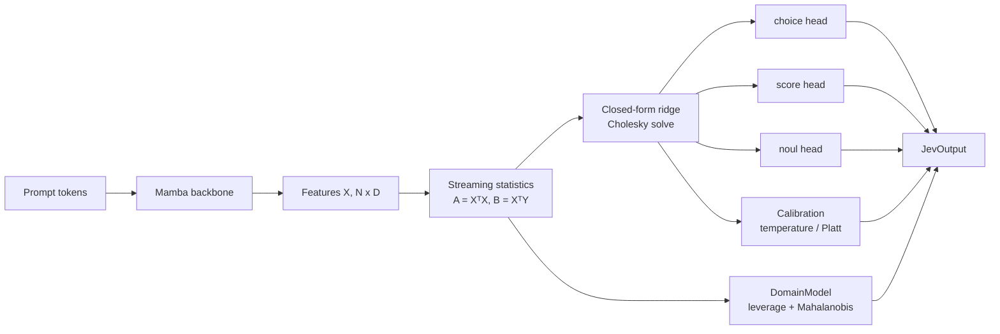

# Mamba-Jev

A Mamba backbone encodes the entire prompt and, in a single forward pass, three linear heads produce: **choice** (N classes), **score** (confidence in [0, 1]) and **noul** (rejection of out-of-domain requests). The heads are computed in **closed form** (streaming least-squares ridge) instead of with gradient descent.

## Table of contents

- [What this version adds](#what-this-version-adds)
- [How it works](#how-it-works)
- [Installation](#installation)
- [Layout](#layout)
- [Quickstart](#quickstart)
- [Choosing the right strategy](#choosing-the-right-strategy)
- [Tests and experiments](#tests-and-experiments)
- [Design notes and limitations](#design-notes-and-limitations)
- [Glossary](#glossary)
- [FAQ](#faq)
- [Contributing](#contributing)
- [Citation](#citation)
- [License](#license)

## What this version adds

Beyond the plain "ridge head", this version provides:

| Feature | What it does | Verification status |
|---|---|---|
| Unpenalized intercept | Heads with bias, estimated from the centered statistics | test vs augmented `lstsq` |
| `select_ridge` (GCV) | Picks rho from the statistics, no pass over the data | test vs explicit hat matrix |
| `select_ridge_holdout` | Picks rho on a held-out set (MSE or accuracy) | test vs explicit computation |
| Exact LOO (`HeadFit.loo_predict`) | `e/(1-h)` from the same Cholesky factor, no refit | test vs refit with the row left out |
| Leverage + Mahalanobis (`DomainModel`) | Rejection from the same statistics, **without OOD data** | test vs explicit Gaussian; CLINC150 |
| `Calibration` | Temperature (choice), Platt (noul), score = calibrated MSP | recovery of known parameters |
| `remove()` / `expand_choices()` | Exact removal of rows and addition of classes | difference vs refit <= 4e-15 |
| `fit_jev_heads` | Pipeline: ridge -> calibration (LOO or held-out) -> domain | CLINC150, three backbones |

> **Read [docs/RESULTS.md](docs/RESULTS.md) before trusting anything here.** It also contains the negative results. In short:
>
> - LOO without a validation set calibrates well only if the backbone has **not** seen the fit rows.
> - The "free" Mahalanobis matches the MSP of a CE head on one backbone and fails on another.
> - The LS head loses 9-16 accuracy points against CE on untrained encoders, but with trained features (Stage 1) and rho chosen on a held-out set it is on par.
> - **No real Mamba backbone has been run.**

## How it works



**Closed-form heads.** For features `X` and targets `Y`, each head solves

```
W = argmin ||XW - Y||² + λ ||W||²   =>   W = (XᵀX + λI)⁻¹ XᵀY
```

Only the sufficient statistics `A = XᵀX` and `B = XᵀY` (plus the means, for the unpenalized intercept) are accumulated, batch by batch. Memory is `O(D²)` regardless of dataset size, and the features never have to be kept.

**Targets live in logit space:** one-hot for `choice`, `logit(clip(s))` for `score`, and `±m` for `noul`.

**Everything else comes for free from the same factorization:**

- **GCV** selects `λ` from the statistics alone.
- **Exact leave-one-out** predictions are `e_i / (1 - h_i)`, where `h_i` is the leverage of row `i`.
- **Domain rejection** uses leverage and Mahalanobis distance computed from the same centered statistics, so no OOD examples are needed.
- **Row removal** and **adding classes** are exact updates, matching a full refit to numerical precision.

**Two-stage flow.** Stage 1 trains the backbone with SGD. Stage 2 freezes it and replaces the heads with the exact solution. Because the ridge heads are not the minimizer of CE/BCE, probabilities are obtained afterwards through `Calibration`.

## Installation

```bash
pip install -e ".[dev]"            # package + pytest (CPU: solver, calibration, training loop, reference SSM)
pip install -e ".[mamba]"          # real backbone (requires CUDA): mamba-ssm, causal-conv1d
pip install -e ".[exp]"            # CLINC150 experiments
```

## Layout

```
src/mamba_jev/
  config.py       MambaJevConfig (backbone + head dimensions, head_bias)
  types.py        JevOutput, JevTargets
  model.py        MambaJevModel: extract_features, predict, inject_exact_weights, load_fit, expand_choice_head
  loss.py         CombinedJevLoss (per-head weights, per-row masking)
  solver.py       ExactHeadSolver: streaming statistics, ridge (GCV/held-out), HeadFit (LOO, leverage), remove, expand_choices
  uncertainty.py  DomainModel (leverage, Mahalanobis), Calibration, fit_temperature, fit_platt
  pipeline.py     fit_jev_heads(): ridge -> calibration -> DomainModel from in-memory features
  metrics.py      ECE, Brier, NLL, AUROC, FPR@TPR, AURC, bootstrap
  tiny_ssm.py     pure-PyTorch selective SSM backbone (CPU, for tests and Stage 1 -> 2 dry runs)
  train.py        train(): SGD branch / exact-solver branch (+ loo_calibration)
tests/            CPU pytest (fake backbone); test_uncertainty.py checks the formulas against explicit computations
experiments/      clinc150_heads.py (head analysis), clinc150_tiny_ssm.py (Stage 1 -> 2), make_report.py
scripts/          smoke_test.py (GPU), extract_features.py (pretrained Mamba, UNTESTED)
docs/             research plan (.tex/.pdf) and RESULTS.md
```

## Quickstart

```python
import torch
from mamba_jev import JevTargets, MambaJevConfig, MambaJevModel, fit_jev_heads

cfg = MambaJevConfig(...)                 # backbone + head dimensions
model = MambaJevModel(cfg)

# features already extracted (N, D) from a FROZEN backbone, plus targets
tgt = JevTargets(choice=y, score=torch.zeros(len(y)), noul=noul)      # choice = -100 on OOD rows
fit = fit_jev_heads(X, tgt, num_choices=150, ridge="gcv", score_mode="msp")

# if the backbone was trained on the same rows (Stage 1): use a held-out set, NOT LOO
fit = fit_jev_heads(X, tgt, 150, ridge="holdout", holdout=(X_val, tgt_val), score_mode="msp")

model.load_fit(fit)                       # weights + intercepts + calibration + DomainModel
out = model.predict(ids, mask)            # choice, choice_probs (calibrated), score, noul_prob, ood_leverage, ood_maha
```

### Two-stage flow with the training loop

Streaming, without keeping the features: only A and B are held in memory, at `O(D²)` cost.

```python
from mamba_jev import CombinedJevLoss, TrainConfig, train

loss_fn = CombinedJevLoss(w_choice=1.0, w_score=0.0, w_noul=0.5)
train(model, loss_fn, loader, TrainConfig(epochs=3), optimizer=opt)                      # Stage 1: SGD
train(model, loss_fn, loader, TrainConfig(use_exact_solver=True, solver_ridge="gcv"))    # Stage 2: exact heads
```

`loo_calibration=True` in `TrainConfig` keeps the features in memory and uses LOO: **valid only with a backbone that was not trained on those rows** (the library emits a warning).

### Batch format produced by `loader`

| key | shape / dtype | notes |
|---|---|---|
| `input_ids` | (B, L) long | **right-padding** recommended |
| `attention_mask` | (B, L) | optional; if absent it is inferred from `pad_token_id` |
| `choice_label` | (B,) long | `-100` where undefined |
| `score_target` | (B,) float in [0, 1] | |
| `noul_label` | (B,) float in {0, 1} | |
| `score_mask` | (B,) bool | optional; if all False the score head stays at zero |

## Choosing the right strategy

| Situation | Ridge `rho` | Calibration | Why |
|---|---|---|---|
| Frozen, untrained backbone (features never fitted on these rows) | `ridge="gcv"` | LOO (`loo_calibration=True`) | The backbone has not seen the rows, so LOO is an honest estimate |
| Backbone trained in Stage 1 on the same rows | `ridge="holdout"` | held-out | LOO would be optimistic: the features already encode the training labels |
| Small dataset, no spare validation data | `ridge="gcv"` | LOO | No pass over the data and no split needed |
| Need to delete data (e.g. privacy requests) | any | any | Use `remove()`; the result matches a refit |
| New classes appear after deployment | any | re-calibrate | Use `expand_choices()`; no retraining of the backbone |

## Tests and experiments

```bash
pytest                                              # 48 CPU tests (1 skipped without GPU/mamba-ssm)
python experiments/clinc150_heads.py --encoder lsa --out results/
python experiments/clinc150_tiny_ssm.py --out results/ && python experiments/make_report.py results/
python scripts/smoke_test.py                        # GPU + mamba-ssm
```

## Design notes and limitations

- The solver minimizes `||XW - Y||² + λ ||W||²` with targets in logit space (one-hot for choice, `logit(clip(s))` for score, `±m` for noul). It is **not** the minimizer of CE/BCE: probabilities are obtained with `Calibration`.
- Statistics are accumulated in fp64 (default) and centered afterwards: with large-mean features, fp32 accumulation suffers from cancellation.
- Exact LOO holds for a fixed `λ` and only for rows used in the fit; it does not account for a backbone trained on those rows.
- `ExactHeadSolver` is the reference implementation; to use another solver it is enough to respect `reset / accumulate / all_reduce / solve`.
- The backbone is injectable (`MambaJevModel(cfg, backbone=...)`): `tiny_ssm.TinySSMBackbone` on CPU, mamba-ssm's `MixerModel` on GPU.
- **Not implemented:** differentiable ridge with a support/query split, Sherman-Morrison updates, conformal guarantees, exact LOO for LDA.
- **Not validated:** no real pretrained Mamba backbone has been run end to end; `scripts/extract_features.py` is untested.

## Glossary

| Term | Meaning |
|---|---|
| **choice** | Multi-class head (N classes), e.g. the intent of the prompt |
| **score** | Confidence in [0, 1] |
| **noul** | "No-utterance-label": binary rejection of out-of-domain requests |
| **ridge** | Least squares with an L2 penalty `λ ||W||²` |
| **GCV** | Generalized Cross-Validation: selects `λ` from the statistics, with no data pass |
| **LOO** | Leave-One-Out: prediction for each row as if it had been excluded from the fit |
| **Leverage** | `h_i`: how much row `i` influences its own prediction (diagonal of the hat matrix) |
| **Mahalanobis** | Distance of a feature vector from the training distribution, scaled by its covariance |
| **MSP** | Maximum Softmax Probability, a standard confidence baseline |
| **ECE / NLL / Brier** | Calibration and probabilistic-quality metrics |
| **AUROC / FPR@TPR / AURC** | OOD detection and selective-prediction metrics |
| **Stage 1 / Stage 2** | Stage 1: train the backbone with SGD. Stage 2: freeze it and solve the heads exactly |

## FAQ

**Why closed-form heads instead of SGD?**
They are deterministic, need no learning-rate tuning, work in a streaming fashion with `O(D²)` memory, and give leave-one-out, leverage, row removal and class expansion almost for free.

**Why are the probabilities not directly meaningful?**
Ridge is fitted on logit-space targets, so its outputs are not calibrated probabilities. `Calibration` (temperature for choice, Platt for noul) maps them to probabilities.

**Can I use this without a GPU?**
Yes for everything except the real Mamba backbone. The solver, calibration, training loop and the reference `TinySSMBackbone` all run on CPU.

**When is LOO calibration safe?**
Only when the backbone has not been trained on the rows used for the fit. Otherwise use a held-out set (`ridge="holdout"`).

**Does the domain rejection need out-of-domain examples?**
No. `DomainModel` uses leverage and Mahalanobis distance computed from the same in-domain statistics. Its quality still depends on the backbone: see the negative results in `docs/RESULTS.md`.

## Contributing

Issues and pull requests are welcome. Before submitting:

1. Run `pytest` and make sure all CPU tests pass.
2. Any new formula should come with a test against an explicit computation, in the style of `tests/test_uncertainty.py`.
3. Report negative results too, and add them to `docs/RESULTS.md`.

## Citation

```bibtex
@software{mamba_jev,
  title  = {Mamba-Jev: Closed-form ridge heads on a Mamba backbone},
  author = {<AUTHOR NAMES>},
  year   = {<YEAR>},
  url    = {<REPOSITORY URL>}
}
```

## License

<!-- Replace with your license, e.g. MIT or Apache-2.0 -->
See the `LICENSE` file.